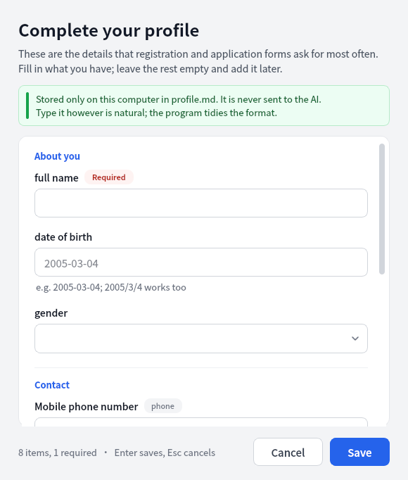
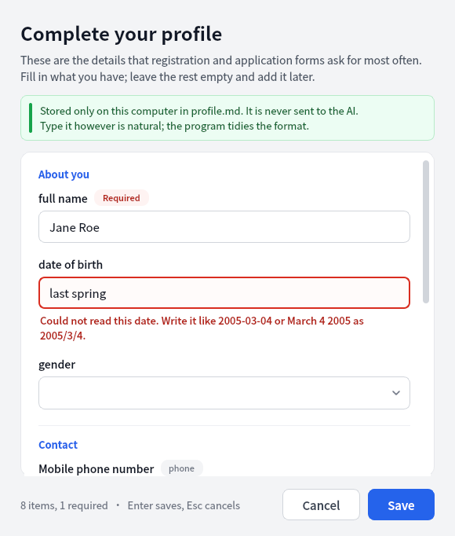

# privfill

**English** · [简体中文](README.zh-CN.md)

Let an AI assistant use your personal details without ever seeing them.

An assistant that fills in a form for you needs your name, ID number and phone number. If it reads them, they are sent to the model provider as part of the conversation. privfill keeps them on your machine: the assistant writes `{{placeholders}}`, and a small local program puts in the real values and reports back only "filled 3 items".

<p align="center"></p>

## How it works

| Step | What the assistant does | What stays on your machine |
|---|---|---|
| Entering | Sends a list of questions (the entry protocol) and gets back "stored: phone" | You type the answers into a local form; they go straight into a local file |
| Writing | Writes the document as a master with `{{phone}}`, `{{date of birth\|YYYY/MM/DD}}` | Nothing: the master contains no real values |
| Filling | Runs `privfill render master output` and gets back "filled phone x1" | The program copies the master and puts in the values |
| Checking | Reviews and edits the master only | You open the output for the final look |

The assistant sees item names, counts and exit codes. It does not see values.

## Install

Requires Python 3.8 or later. The form uses PyQt6 when it is available and falls back to a plain Tk form otherwise.

```
git clone https://github.com/OWNER/privfill.git
cd privfill
./install.sh            # program and data file in ~/.privfill
./install.sh --skill    # also install the Claude Code skill
```

Then give your assistant the rules, described in [AGENT_GUIDE.md](AGENT_GUIDE.md), and for Claude Code add the permission rules in [docs/claude-code.md](docs/claude-code.md).

## A session, from your side

You say: *"Fill in the registration form. My phone number isn't stored yet."*

1. The assistant tells you a form is about to appear, and it does. You type `138 0013 8000`; the program stores `13800138000`.
2. The assistant writes `registration.docx` with `{{full name}}` and `{{phone}}` in it and checks the layout.
3. It runs `privfill render`. A filled copy appears in `out/`.
4. You open the copy and check it.

You never told the assistant your phone number, and it never read the filled copy.

## Entering details without learning a format

The assistant describes each question with a type, and the program tidies whatever you type:

| Type | You can type | Stored as |
|---|---|---|
| `date` | `2005-3-4`, `2005/03/04`, `2005年3月4日` | `2005-03-04` |
| `phone` | `+86 138-0013 8000` | `13800138000` |
| `id_card` | an 18-character PRC resident ID, with spaces or a lower-case x | cleaned, check digit verified |
| `email` | an address with stray spaces | trimmed and checked |
| `number` | `1,750`, full-width digits | `1750` |
| `choice` | pick from a list | the option |
| `text` | anything on one line | as typed |

If an answer cannot be read, the form says why under that field and stays open.

<p align="center"></p>

The same stored detail can come out in different shapes, chosen by the assistant per document:

| Placeholder | Result |
|---|---|
| `{{date of birth}}` | `2005-03-04` |
| `{{date of birth\|D.M.YYYY}}` | `4.3.2005` |
| `{{date of birth\|年月日}}` | `2005年3月4日` |
| `{{phone\|last4}}` | `8000` |

## Commands

```
privfill.py init                       create the data file
privfill.py keys                       list item names
privfill.py form '<JSON>' | <file>     show an entry form
privfill.py add <item>                 enter one free-text item
privfill.py render <master> <output>   fill a copy of a master
privfill.py fill <file>...             fill files in place
privfill.py run -- <cmd> [args]...     run a command with placeholders in its arguments
privfill.py protocol                   print the entry protocol summary
```

Works on Word, Excel and PowerPoint files, Jupyter notebooks, JSON and any text file, and in file names. Add `--json` before the subcommand for machine-readable output. The full contract, including exit codes, is in [PROTOCOL.md](PROTOCOL.md). Sample protocols and masters are in [examples/](examples/).

## Languages

| Part | Read by | Language |
|---|---|---|
| The entry form | you | English or Chinese, from the system locale or `PRIVFILL_LANG=en\|zh` |
| Questions, hints, item names | you | whatever the assistant writes; any language works |
| Command output, `SKILL.md`, `PROTOCOL.md` | the assistant | English only |

Keeping the assistant-facing text in one language means there is one set of rules to maintain. Adding a form language is one entry per string in the `UI` table at the top of `privfill.py`.

## What it protects, and what it does not

privfill keeps values out of everything the assistant sends and receives, **provided the assistant follows the rules**. It is a convention plus a tool, not a sandbox.

- An assistant that can read files could read the data file or a filled output. Use your tool's permission system so that every access needs your approval; for Claude Code this takes three lines of settings.
- Anything you type into the chat has already been sent. Use the form.
- Filled outputs are ordinary files with your details in them. Where they go next is up to you.
- The data file is plain text with mode 600. That keeps out other users of the machine, not other programs running as you. It is not encrypted.
- The `id_card` type validates PRC resident ID numbers only. Use `text` with a `pattern` for other documents.

## Tests

```
python3 -m unittest discover -s tests
```

The tests use fake data in a temporary directory and never open a window.

## License

MIT
