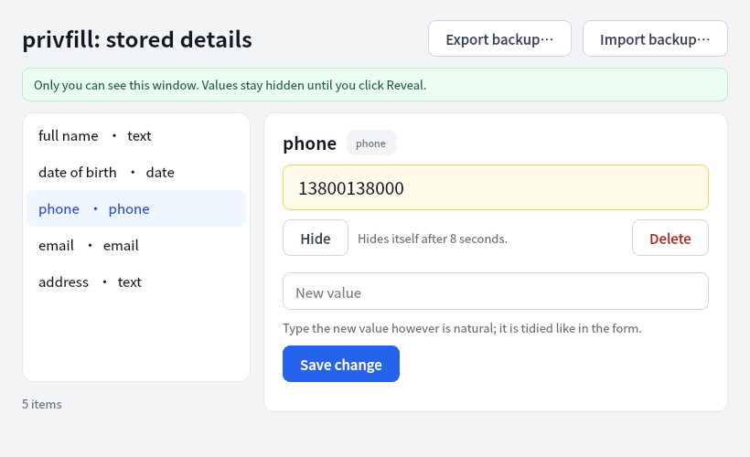

# privfill

**English** · [简体中文](README.zh-CN.md)

Let an AI assistant use your personal details without ever seeing them.

An assistant that fills in a form for you needs your name, ID number and phone number. If it reads them, they are sent to the model provider as part of the conversation. privfill keeps them on your machine: the assistant writes `{{placeholders}}`, and a small local program puts in the real values and reports back only "filled 3 items".

<p align="center"></p>

## How it works

| Step | What the assistant does | What stays on your machine |
|---|---|---|
| Entering | Sends a list of questions (the entry protocol) and gets back "stored: phone" | You type the answers into a local form; they go straight into a local file |
| Writing | Writes the document as a master with `{{phone}}`, `{{date of birth\|YYYY/MM/DD}}` | Nothing: the master contains no real values |
| Filling | Runs `privfill render master output` and gets back "filled phone x1" | The program copies the master and puts in the values |
| Checking | Reviews and edits the master only | You open the output for the final look |

The assistant sees item names, counts and exit codes. It does not see values.

## Install

Requires Python 3.8 or later and the `cryptography` library from the system package manager (`python-cryptography` on Arch, `python3-cryptography` on Debian, Ubuntu and Fedora). The form uses PyQt6 when it is available and falls back to a plain Tk form otherwise.

```
git clone https://github.com/AuspexG/privfill.git
cd privfill
./install.sh            # program in ~/.privfill; the vault is created there on first use
./install.sh --skill    # also install the Claude Code skill
```

Then give your assistant the rules, described in [AGENT_GUIDE.md](AGENT_GUIDE.md), and for Claude Code add the permission rules in [docs/claude-code.md](docs/claude-code.md).

## A session, from your side

You say: *"Fill in the registration form. My phone number isn't stored yet."*

1. The assistant tells you a form is about to appear, and it does. You type `138 0013 8000`; the program stores `13800138000`.
2. The assistant writes `registration.docx` with `{{full name}}` and `{{phone}}` in it and checks the layout.
3. It runs `privfill render`. A filled copy appears in `out/`.
4. You open the copy and check it.

You never told the assistant your phone number, and it never read the filled copy.

## Entering details without learning a format

The assistant describes each question with a type, and the program tidies whatever you type:

| Type | You can type | Stored as |
|---|---|---|
| `date` | `2005-3-4`, `2005/03/04`, `2005年3月4日` | `2005-03-04` |
| `phone` | `+86 138-0013 8000` | `13800138000` |
| `id_card` | an 18-character PRC resident ID, with spaces or a lower-case x | cleaned, check digit verified |
| `email` | an address with stray spaces | trimmed and checked |
| `number` | `1,750`, full-width digits | `1750` |
| `choice` | pick from a list | the option |
| `text` | anything on one line | as typed |

If an answer cannot be read, the form says why under that field and stays open.

<p align="center"></p>

The same stored detail can come out in different shapes, chosen by the assistant per document:

| Placeholder | Result |
|---|---|
| `{{date of birth}}` | `2005-03-04` |
| `{{date of birth\|D.M.YYYY}}` | `4.3.2005` |
| `{{date of birth\|年月日}}` | `2005年3月4日` |
| `{{phone\|last4}}` | `8000` |

## Commands

```
privfill.py init                       create the vault
privfill.py keys                       list item names
privfill.py form '<JSON>' | <file>     show an entry form
privfill.py add <item>                 enter one free-text item
privfill.py manage                     open the local manager window (for you)
privfill.py render <master> <output>   fill a copy of a master
privfill.py fill <file>...             fill files in place
privfill.py pack <archive> <file>...   bundle files into a zip archive
privfill.py verify                     check the activity log
privfill.py restore [<version>]        list the vault's backups, or put one back
privfill.py protocol                   print the entry protocol summary
privfill.py guard                      answer a tool hook: may this call go ahead?
privfill.py mcp                        serve the tools as an MCP server (stdin/stdout)
```

Works on Word, Excel and PowerPoint files, Jupyter notebooks, JSON and any text file, and in file names. The program never passes a detail to another program, so none is ever put on a command line. Add `--json` before the subcommand for machine-readable output. The full contract, including exit codes, is in [PROTOCOL.md](PROTOCOL.md). Sample protocols and masters are in [examples/](examples/).

## Looking at what is stored

Once the vault is encrypted, `privfill.py manage` is how you see what it holds. It opens a local window (PyQt6 required) and prints nothing to the terminal.

<p align="center"></p>

- A value is hidden until you click **Reveal**, and hides itself after 8 seconds, or when you pick another item.
- **Save change** tidies what you type by the item's type, exactly like the entry form, and says why when it cannot read it. A `choice` item is checked as text, because the list of choices is not stored.
- **Delete** asks first.
- **Export backup** writes a new file encrypted under a passphrase you choose for it (the same format as the vault; an existing file is never overwritten). **Import backup** restores it, and asks before replacing items that already exist.

This window is for you, not the assistant: it never prints a value, but anything on screen is on screen. The screenshot above was rendered from fake data by the off-screen test hook (`PRIVFILL_MANAGER_SHOT`, see `privfill/manager_ui.py`).

## Languages

| Part | Read by | Language |
|---|---|---|
| The entry form | you | English or Chinese, from the system locale or `PRIVFILL_LANG=en\|zh` |
| Questions, hints, item names | you | whatever the assistant writes; any language works |
| Command output, `SKILL.md`, `PROTOCOL.md` | the assistant | English only |

Keeping the assistant-facing text in one language means there is one set of rules to maintain. Adding a form language is one entry per string in the `UI` table in `privfill/texts.py`.

## What it protects, and what it does not

privfill keeps values out of everything the assistant sends and receives, **provided the assistant follows the rules**. It is a convention plus a tool, not a sandbox.

- An assistant that can read files could read a filled output, and could see the names of your items in the vault. Use your tool's permission system so that every access needs your approval; for Claude Code this takes three lines of settings.
- Anything you type into the chat has already been sent. Use the form.
- Filled outputs are ordinary files with your details in them. Where they go next is up to you.
- Your details are stored in an encrypted vault, unlocked by a passphrase you type into a local window each time they are used. Someone who gets the file without the passphrase learns the item names, not the values. It does not protect against a program running as you while you type the passphrase, and a forgotten passphrase cannot be recovered. The format and the full boundary are in [docs/vault.md](docs/vault.md).
- A plain-text `profile.md` from an earlier version is not read or migrated yet: enter the details again and remove the old file yourself.
- The `id_card` type validates PRC resident ID numbers only. Use `text` with a `pattern` for other documents.

## Layout

`privfill.py` is a launcher; the program is the `privfill/` package beside it, and the two are installed together.

| Module | Holds |
|---|---|
| `cli.py` | the commands and what they report |
| `store.py` | the `Store` interface (create, list names, read, write and delete one item), its errors, and the plain-text data file of earlier versions |
| `vault.py` | the encrypted vault the commands use, and the unlock methods |
| `normalize.py` | the rules that tidy each type of answer |
| `protocol.py` | validation of the entry protocol, and its summary |
| `manager.py` | what the manager window does: list, reveal, edit, delete, back up, restore |
| `manager_ui.py` | the manager window (PyQt6) and its off-screen test hook |
| `form.py` | the entry form and the passphrase dialog (PyQt6, with a Tk fallback) |
| `filling.py` | placeholders, formats and the file types they are filled in |
| `texts.py` | the usage text and the form's strings in each language |
| `packing.py` | bundling files into a zip archive |
| `activity.py` | the value-free, hash-chained activity log |
| `atomic.py` | writing or replacing a file in one step |
| `hardening.py` | no core dumps, process not inspectable (see `PROTOCOL.md` 6.1) |
| `registry.py` | the record of which files were filled with real values |
| `guard.py` | the decision whether a tool call may touch the data directory or an output ([docs/guard.md](docs/guard.md)) |
| `mcp_server.py` | the Model Context Protocol server: typed tools for keys, form, render and pack ([docs/claude-code.md](docs/claude-code.md)) |

Commands reach items only through a `Store`, so another way of keeping them needs a new backend and nothing else. A store that keeps its data in a directory says which in `directory`; the output registry lives there.

## Tests

```
python3 -m unittest discover -s tests
```

The tests need the `cryptography` library. They use fake data in a temporary directory and never open a window. `tests/test_store_seam.py` runs the commands against an in-memory `Store`. `tests/test_no_value_escapes.py` feeds every command hostile input and checks that no fragment of a value is printed; a new command must be listed in `COMMANDS` in `privfill/cli.py` and given scenarios in that test file, or the suite fails.

## License

MIT
