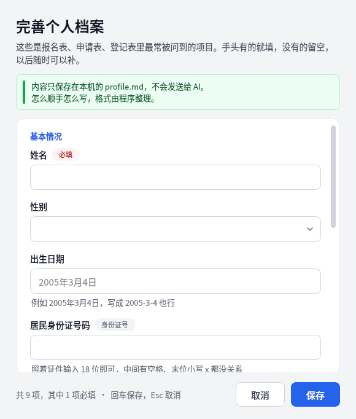

# privfill

[English](README.md) · **简体中文**

让 AI 助手用上你的个人信息，却看不到它。

让助手替你填表，它就需要你的姓名、证件号、手机号。它一旦读到这些内容，内容就会作为对话的一部分发送给模型提供方。privfill 把这些信息留在本机：助手只写 `{{占位符}}`，由本机的一个小程序填入真实内容，助手得到的回报只有"填入 3 项"。

<p align="center"></p>

## 工作方式

| 环节 | 助手做什么 | 什么留在本机 |
|---|---|---|
| 录入 | 发送一组问题（录入协议），得到"已录入：手机号" | 你在本机表单里填写，内容直接写进本机文件 |
| 撰写 | 把文档写成母版，里面是 `{{手机号}}`、`{{出生日期\|年月日}}` | 没有：母版里没有真实内容 |
| 填充 | 运行 `privfill render 母版 成品`，得到"手机号 x1" | 程序复制母版并填入内容 |
| 检查 | 只检查和修改母版 | 你打开成品做最终核对 |

助手看到的是项目名、计数和退出码，看不到内容。

## 安装

需要 Python 3.8 以上。表单界面优先使用 PyQt6，没有时退回到较简陋的 Tk 界面。

```
git clone https://github.com/OWNER/privfill.git
cd privfill
./install.sh            # 程序和数据文件放在 ~/.privfill
./install.sh --skill    # 同时安装 Claude Code skill
```

然后把规则交给你的助手，见 [AGENT_GUIDE.md](AGENT_GUIDE.md)（英文）。Claude Code 用户再按 [docs/zh-CN/claude-code.md](docs/zh-CN/claude-code.md) 加上权限规则。

## 一次使用，从你这边看

你说："帮我填报名表，我的手机号还没存。"

1. 助手告诉你要弹出表单，表单出现。你输入 `138 0013 8000`，程序存成 `13800138000`。
2. 助手写出 `报名表.docx`，里面是 `{{姓名}}` 和 `{{手机号}}`，并检查版式。
3. 助手运行 `privfill render`，填好的副本出现在 `成品/` 里。
4. 你打开副本核对。

你没有把手机号告诉助手，助手也没有读过填好的副本。

## 录入时不用记格式

助手给每个问题标上类型，你怎么顺手怎么写，程序负责整理：

| 类型 | 你可以这样写 | 存成 |
|---|---|---|
| `date` 日期 | `2005年3月4日`、`2005-3-4`、`20050304` | `2005-03-04` |
| `phone` 电话 | `+86 138-0013 8000` | `13800138000` |
| `id_card` 身份证号 | 18 位，带空格、小写 x 都行 | 去空格、大写 X，并校验末位 |
| `email` 邮箱 | 前后带空格 | 去空格并检查格式 |
| `number` 数字 | `1,750`、全角数字 | `1750` |
| `choice` 选择 | 在下拉框里选 | 选中的那一项 |
| `text` 文字 | 任意一行话 | 原样 |

填的内容程序看不懂时，表单会在那一项下面说明原因，改好才能保存。整理靠固定规则，不靠语言理解，所以"零五年三月"这种没有数字的写法日期栏不接受。

同一项信息可以按文档需要以不同格式输出，由助手在占位符里指定，你不用重新录入：

| 占位符 | 结果 |
|---|---|
| `{{出生日期}}` | `2005-03-04` |
| `{{出生日期\|年月日}}` | `2005年3月4日` |
| `{{出生日期\|YYYY/MM/DD}}` | `2005/03/04` |
| `{{身份证号\|后4位}}` | 末四位 |

## 命令

```
privfill.py init                       创建数据文件
privfill.py keys                       列出项目名
privfill.py form '<JSON>' | <文件>     弹出录入表单
privfill.py add <项目名>               录入一项文字
privfill.py render <母版> <成品路径>   填充母版的副本
privfill.py fill <文件>...             就地填充
privfill.py run -- <命令> [参数]...    运行参数里带占位符的命令
privfill.py protocol                   打印录入协议摘要
```

支持 Word、Excel、PowerPoint 文件、Jupyter notebook、JSON 和任意文本文件，文件名里也能用占位符。在子命令前加 `--json` 得到机器可读的输出。完整约定（含退出码）见 [PROTOCOL.md](PROTOCOL.md)（英文）。协议和母版的例子在 [examples/zh-CN/](examples/zh-CN/)。

## 语言

| 部分 | 谁来读 | 语言 |
|---|---|---|
| 录入表单 | 你 | 中文或英文，跟随系统语言，或用 `PRIVFILL_LANG=zh\|en` 指定 |
| 问题、提示、项目名 | 你 | 助手怎么写就怎么显示，任何语言都可以 |
| 命令输出、`SKILL.md`、`PROTOCOL.md` | 助手 | 只有英文 |

给助手读的内容只用一种语言，规则就只需要维护一份。给表单增加一种语言，只要在 `privfill.py` 开头的 `UI` 表里给每条文字加一项。

## 它保护什么，不保护什么

**在助手遵守规则的前提下**，privfill 让个人信息的内容不出现在助手发出和收到的任何东西里。它是一套约定加一个工具，不是沙箱。

- 助手只要有读文件的能力，就读得到数据文件和填好的成品。请配合你所用工具的权限机制，让每次访问都需要你批准；Claude Code 里只要三行设置。
- 你在对话里直接说出的内容已经发送出去了。请用表单录入。
- 填好的成品是普通文件，里面是明文。它之后去哪里由你决定。
- 数据文件是权限 600 的明文文件，防的是这台机器上的其他用户，不是以你的身份运行的其他程序。它没有加密。
- `id_card` 类型只校验中国大陆居民身份证号。其他证件请用 `text` 加 `pattern`。

## 测试

```
python3 -m unittest discover -s tests
```

测试全部使用临时目录里的假数据，不会弹出窗口。

## 许可

MIT
