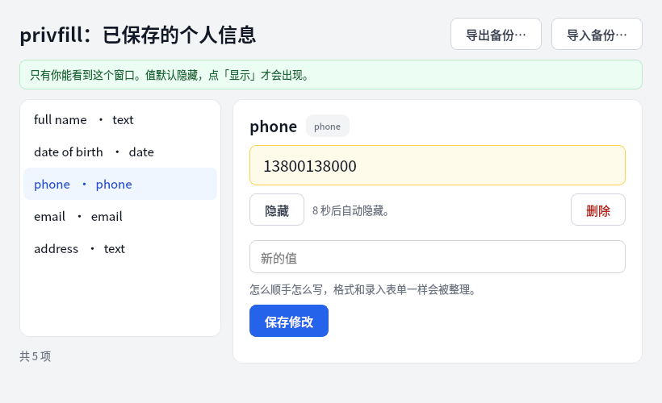

# privfill

[English](README.md) · **简体中文**

让 AI 助手用上你的个人信息，却看不到它。

让助手替你填表，它就需要你的姓名、证件号、手机号。它一旦读到这些内容，内容就会作为对话的一部分发送给模型提供方。privfill 把这些信息留在本机：助手只写 `{{占位符}}`，由本机的一个小程序填入真实内容，助手得到的回报只有"填入 3 项"。

<p align="center"></p>

## 工作方式

| 环节 | 助手做什么 | 什么留在本机 |
|---|---|---|
| 录入 | 发送一组问题（录入协议），得到"已录入：手机号" | 你在本机表单里填写，内容直接写进本机文件 |
| 撰写 | 把文档写成母版，里面是 `{{手机号}}`、`{{出生日期\|年月日}}` | 没有：母版里没有真实内容 |
| 填充 | 运行 `privfill render 母版 成品`，得到"手机号 x1" | 程序复制母版并填入内容 |
| 检查 | 只检查和修改母版 | 你打开成品做最终核对 |

助手看到的是项目名、计数和退出码，看不到内容。

## 安装

需要 Python 3.8 以上，以及用系统包管理器安装的 `cryptography` 库（Arch 上是 `python-cryptography`，Debian、Ubuntu、Fedora 上是 `python3-cryptography`），以及用于桌面密钥环解锁的 `secretstorage`（`python-secretstorage`、`python3-secretstorage`）；没有它时改用口令。表单界面优先使用 PyQt6，没有时退回到较简陋的 Tk 界面。

```
git clone https://github.com/AuspexG/privfill.git
cd privfill
./install.sh            # 程序放在 ~/.privfill，保险库在第一次使用时创建在那里
./install.sh --skill    # 同时安装 Claude Code skill
```

然后把规则交给你的助手，见 [AGENT_GUIDE.md](AGENT_GUIDE.md)（英文）。Claude Code 用户再按 [docs/zh-CN/claude-code.md](docs/zh-CN/claude-code.md) 加上权限规则。

## 一次使用，从你这边看

你说："帮我填报名表，我的手机号还没存。"

1. 助手告诉你要弹出表单，表单出现。你输入 `138 0013 8000`，程序存成 `13800138000`。
2. 助手写出 `报名表.docx`，里面是 `{{姓名}}` 和 `{{手机号}}`，并检查版式。
3. 助手运行 `privfill render`，填好的副本出现在 `成品/` 里。
4. 你打开副本核对。

你没有把手机号告诉助手，助手也没有读过填好的副本。

## 录入时不用记格式

助手给每个问题标上类型，你怎么顺手怎么写，程序负责整理：

| 类型 | 你可以这样写 | 存成 |
|---|---|---|
| `date` 日期 | `2005年3月4日`、`2005-3-4`、`20050304` | `2005-03-04` |
| `phone` 电话 | `+86 138-0013 8000` | `13800138000` |
| `id_card` 身份证号 | 18 位，带空格、小写 x 都行 | 去空格、大写 X，并校验末位 |
| `email` 邮箱 | 前后带空格 | 去空格并检查格式 |
| `number` 数字 | `1,750`、全角数字 | `1750` |
| `choice` 选择 | 在下拉框里选 | 选中的那一项 |
| `text` 文字 | 任意一行话 | 原样 |

填的内容程序看不懂时，表单会在那一项下面说明原因，改好才能保存。整理靠固定规则，不靠语言理解，所以"零五年三月"这种没有数字的写法日期栏不接受。

同一项信息可以按文档需要以不同格式输出，由助手在占位符里指定，你不用重新录入：

| 占位符 | 结果 |
|---|---|
| `{{出生日期}}` | `2005-03-04` |
| `{{出生日期\|年月日}}` | `2005年3月4日` |
| `{{出生日期\|YYYY/MM/DD}}` | `2005/03/04` |
| `{{身份证号\|后4位}}` | 末四位 |

## 命令

```
privfill.py init                       创建保险库
privfill.py keys                       列出项目名
privfill.py form '<JSON>' | <文件>     弹出录入表单
privfill.py add <项目名>               录入一项文字
privfill.py manage                     打开本地管理窗口（给你自己用）
privfill.py render <母版> <成品路径>   填充母版的副本
privfill.py fill <文件>...             就地填充
privfill.py pack <压缩包> <文件>...    把文件打包成 zip
privfill.py verify                     检查操作日志是否被改动
privfill.py restore [<版本>]           列出保险库的备份，或恢复其中一个
privfill.py unlock [add|change|remove] [keyring|passphrase]
                                       查看或更改保险库的解锁方式
privfill.py protocol                   打印录入协议摘要
privfill.py guard                      供工具钩子调用：这次调用可以放行吗？
privfill.py mcp                        作为 MCP 服务提供这些工具（标准输入输出）
```

支持 Word、Excel、PowerPoint 文件、Jupyter notebook、JSON 和任意文本文件，文件名里也能用占位符。程序不会把个人信息交给别的程序，所以它不会出现在任何命令行上。在子命令前加 `--json` 得到机器可读的输出。完整约定（含退出码）见 [PROTOCOL.md](PROTOCOL.md)（英文）。协议和母版的例子在 [examples/zh-CN/](examples/zh-CN/)。

## 查看已保存的内容

保险库加密之后，`privfill.py manage` 是你查看里面内容的唯一办法。它打开一个本地窗口（需要 PyQt6），不会向终端输出任何东西。

<p align="center"></p>

- 值默认隐藏，点「显示」才出现，8 秒后或切换到别的项时自动隐藏。
- 「保存修改」按该项的类型整理你输入的内容，规则和录入表单完全一样，读不懂时会说明原因。`choice` 类型的项按文字检查，因为可选项列表没有保存。
- 「删除」前会先确认。
- 「导出备份」写出一个新文件，用你为它单独设置的口令加密（格式与保险库相同，不会覆盖已有文件）。「导入备份」把它恢复回来，遇到已存在的项会先问你是否替换。

这个窗口是给你用的，不是给助手用的：它不会打印任何值，但屏幕上显示的内容就是显示出来了。上面的截图由离屏测试钩子用假数据渲染。

## 语言

| 部分 | 谁来读 | 语言 |
|---|---|---|
| 录入表单 | 你 | 中文或英文，跟随系统语言，或用 `PRIVFILL_LANG=zh\|en` 指定 |
| 问题、提示、项目名 | 你 | 助手怎么写就怎么显示，任何语言都可以 |
| 命令输出、`SKILL.md`、`PROTOCOL.md` | 助手 | 只有英文 |

给助手读的内容只用一种语言，规则就只需要维护一份。给表单增加一种语言，只要在 `privfill/texts.py` 的 `UI` 表里给每条文字加一项。

## 它保护什么，不保护什么

**在助手遵守规则的前提下**，privfill 让个人信息的内容不出现在助手发出和收到的任何东西里。它是一套约定加一个工具，不是沙箱。

- 助手只要有读文件的能力，就读得到填好的成品，也看得到保险库里各项的名称。请配合你所用工具的权限机制，让每次访问都需要你批准；Claude Code 里只要三行设置。
- 你在对话里直接说出的内容已经发送出去了。请用表单录入。
- 填好的成品是普通文件，里面是明文。它之后去哪里由你决定。
- 个人信息保存在加密的保险库里，每次使用时由你在本机窗口里输入口令解锁。拿到文件却没有口令的人只能看到项目名，看不到内容。它防不了在你输入口令时以你的身份运行的程序；口令忘了无法找回。文件格式和完整的保护边界见 [docs/vault.md](docs/vault.md)（英文）。
- 早期版本留下的明文 `profile.md` 目前不会被读取或迁移：请重新录入，并自行删除旧文件。
- `id_card` 类型只校验中国大陆居民身份证号。其他证件请用 `text` 加 `pattern`。

## 代码结构

`privfill.py` 只是启动入口，程序本体是旁边的 `privfill/` 包，两者一起安装。

| 模块 | 内容 |
|---|---|
| `cli.py` | 各个命令和它们的输出 |
| `store.py` | `Store` 接口（创建、列出项目名、读、写、删除一项）、它的错误类型，以及早期版本的明文数据文件 |
| `vault.py` | 各命令使用的加密保险库，以及解锁方式 |
| `normalize.py` | 各类型答案的整理规则 |
| `protocol.py` | 录入协议的校验和摘要 |
| `manager.py` | 管理窗口的逻辑：列出、显示、修改、删除、备份、恢复 |
| `manager_ui.py` | 管理窗口（PyQt6）及其离屏测试钩子 |
| `form.py` | 录入表单和口令窗口（PyQt6，没有时退回 Tk） |
| `filling.py` | 占位符、格式和各种文件类型的填充 |
| `texts.py` | 用法说明和表单各语言的文字 |
| `packing.py` | 把文件打包成 zip |
| `activity.py` | 不含任何值、哈希链式的操作日志 |
| `atomic.py` | 一步写入或替换文件 |
| `hardening.py` | 禁用核心转储，使进程不可被检查（见 `PROTOCOL.md` 6.1） |
| `registry.py` | 记录哪些文件已被填入真实内容 |
| `guard.py` | 判断一次工具调用是否会触及数据目录或已填好的输出文件（见 [docs/guard.md](docs/guard.md)） |
| `mcp_server.py` | Model Context Protocol 服务：keys、form、render、pack 的类型化工具（见 [docs/zh-CN/claude-code.md](docs/zh-CN/claude-code.md)） |

命令只通过 `Store` 接触个人信息，所以换一种保存方式只需要加一个后端。

## 测试

```
python3 -m unittest discover -s tests
```

测试全部使用临时目录里的假数据，不会弹出窗口。`tests/test_store_seam.py` 用一个放在内存里的 `Store` 来运行各个命令。`tests/test_no_value_escapes.py` 向每个命令输入恶意或损坏的内容，并检查输出中没有任何内容片段；新增命令必须列入 `privfill/cli.py` 的 `COMMANDS` 并在该测试中添加场景，否则测试失败。

## 许可

MIT
